# drawing-excalidraw-figures

**Tiếng Việt** · [English](README.en.md)

<p align="center">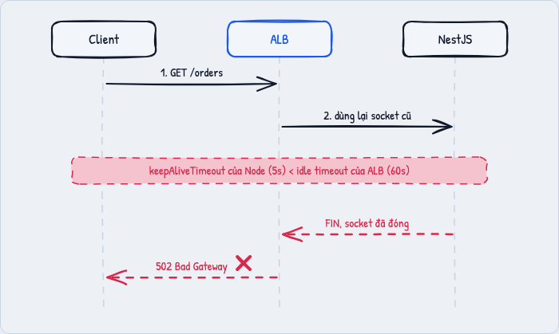</p>

Biến một đoạn văn kỹ thuật, hay một ý tưởng còn thô mới chỉ có chữ, thành hình Excalidraw nét vẽ tay - không phải hàng hộp nối mũi tên, mà hình làm cho thời gian thành độ dài, dữ liệu thành ô có giá trị thật, giới hạn thành một đường kẻ.
Skill cho Claude Code, Codex CLI, hoặc agent nào đọc được SKILL.md: bạn đưa đoạn văn, agent viết spec JSON ngắn, chạy một lệnh, ra bốn file.

[Xem demo 8 mẫu mới](#demo-8-mẫu-mới)

```
fig.excalidraw   cảnh gốc - kéo vào excalidraw.com để sửa tiếp
fig.svg          SVG tĩnh, màu theo token var(--token), chạy chế độ sáng lẫn tối
fig-light.png    bản xem trước ở cột đọc 666px, chế độ sáng
fig-dark.png     bản xem trước, chế độ tối
```

**Vì sao đáng dùng:**

- **Sửa tiếp được** - `.excalidraw` mở trên excalidraw.com, kéo thả chỉnh như bản vẽ tay thật
- **Hai chế độ màu chuẩn** - SVG tô bằng token, không bao giờ lệch ở dark mode
- **Offline hoàn toàn** - engine, bundle Chromium và font nằm trong repo; không API, không cần mạng
- **Tool gác cổng** - chặn chữ tràn, mũi tên xuyên hộp, màu sai token ngay lúc render; phần còn lại mắt bạn quyết định

Xem skill vẽ ra gì khi bốn model AI thi nhau vẽ: [32 hình, tám đề](https://drawing-excalidraw-figures.vercel.app/#so-sanh).

## Không chỉ cho kỹ thuật

Một pitch kinh doanh, một khái niệm cần giảng, một đoạn note rối lúc 2 giờ sáng, một quy trình nội bộ: ý nào cũng có hình dạng riêng.
Với ý tưởng thô, skill viết thêm một câu "ý này thực chất nói rằng...", liệt kê khái niệm, quan hệ và chỗ căng thẳng bằng đúng chữ của người viết, rồi chọn hình theo cấu trúc của ý: vòng nhân quả, ma trận 2x2, phễu, concept map, timeline, swimlane.
Nếu có người để hỏi, skill đưa bản nháp đầu tiên và hỏi "đúng ý bạn chưa?" trước khi trau chuốt.

<p align="center">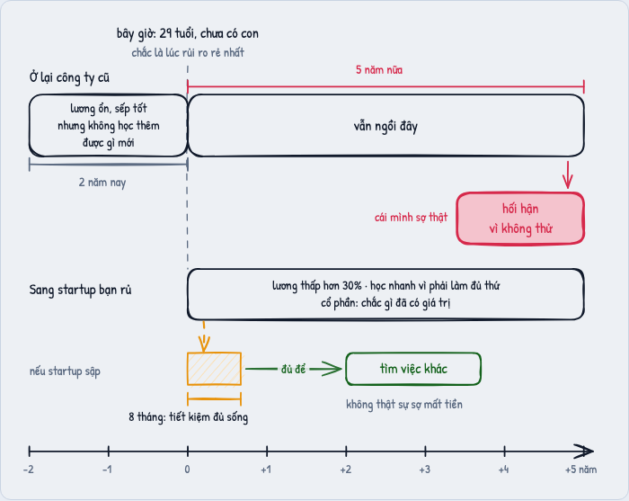</p>

Bốn đề phi kỹ thuật nằm trong `evals/`, kết quả và bài học trong `references/lessons-from-runs.md`.

## Luật chịu lực

**Vẽ HÌNH DẠNG của ý tưởng, không vẽ danh sách thành phần.**
Một hàng hộp chữ nhật nối mũi tên chỉ nói "A gọi B" - điều một câu văn đã nói xong.
Hình tốt làm cho thời gian thành độ dài, dữ liệu thành ô có giá trị thật, giới hạn thành một đường kẻ, sự cố thành một nét đỏ.

Skill rút ra từ khoảng 600 hình Excalidraw thật của Hello Interview và bộ mẫu của chủ sở hữu:
không đoán, mọi luật đều có nguồn ghi trong `references/sources.md`.

## Quy trình sáu bước

1. Viết đúng một câu: "Nhìn hình này, người đọc THẤY ... mà đoạn văn không cho thấy." Không viết được câu đó thì không vẽ.
2. Ghi danh sách sự thật: actor, bước, nhánh lỗi, số thật lấy nguyên từ nguồn. Với ý tưởng thô: khái niệm, quan hệ, chỗ căng thẳng và điều người viết muốn người đọc tin.
3. Chọn loại hình theo cái cần thấy (sequence, swimlane, state, ER, byte cells, timeline, threshold...).
4. Viết spec JSON - chép template từ `examples/`, không viết từ đầu.
5. Render bằng `ve.py`.
6. Mở cả hai PNG ra soi, sửa tới khi hình nói được câu của bước 1. Tool xanh chưa có nghĩa là hình đọc được.

## Cài đặt

Yêu cầu: Python 3.11+, Playwright Chromium, và font nằm sẵn trong `assets/fonts/` (không tải gì từ mạng lúc render).

```bash
git clone https://github.com/minhat0601/drawing-excalidraw-figures.git
cd drawing-excalidraw-figures
pip install -r requirements.txt
python3 -m playwright install chromium

# chạy thử ngay một ví dụ có sẵn
python3 scripts/ve.py examples/03-byte-cells.json --out /tmp/fig
open /tmp/fig/03-byte-cells-light.png
```

Để Claude Code dùng như skill, đặt cả thư mục vào thư mục skill của bạn:

```bash
mkdir -p ~/.claude/skills
cp -R drawing-excalidraw-figures ~/.claude/skills/
```

Nếu đã cài bằng Git và đang ở nhánh `main`, cập nhật bản skill như sau.

```bash
git -C ~/.claude/skills/drawing-excalidraw-figures pull --ff-only origin main
```

Codex CLI đọc cùng chuẩn `SKILL.md`, chỉ khác thư mục cài.
Một bản duy nhất phục vụ cả hai bằng symlink:

```bash
mkdir -p ~/.codex/skills
ln -s ~/.claude/skills/drawing-excalidraw-figures ~/.codex/skills/drawing-excalidraw-figures
```

## Agent khác: Antigravity, Cursor, Gemini CLI, Copilot

Skill về bản chất là một bản dẫn Markdown cộng một CLI Python, nên agent nào đọc được file và chạy được lệnh đều dùng được - Antigravity, Cursor, Windsurf, Gemini CLI, GitHub Copilot coding agent.
Tool không có thư mục skill thì thêm vài dòng vào file rules của nó (`AGENTS.md`, `.cursor/rules`, `.windsurfrules`, `.github/copilot-instructions.md`):

```text
Khi được yêu cầu vẽ sơ đồ, đọc <đường-dẫn-đến-repo>/SKILL.md
và làm theo đúng quy trình sáu bước trong đó.
```

Bước 6 (soi hai PNG) cần agent nhìn được ảnh; các model chính đều làm được.
Model không đa phương tiện vẫn vẽ được, chỉ cần bạn tự mở PNG ra soi.

`ve.py` tự tìm thư mục `engine/` đi lên từ vị trí của nó, nên đặt ở `.claude/skills/` của người dùng hay của một dự án lớn hơn đều chạy được.

## Spec trong 30 giây

```json
{
  "_": "Người đọc THẤY pool 10 connection không đủ cho 14 request, 4 request timeout ở giây 2 trước khi connection đầu tiên trả lại ở giây 3.",
  "elements": [
    {"t":"axis","x":60,"y":352,"length":510,"gap":170,"ticks":["0s","1s","2s","3s"],"label":"t"},
    {"t":"span","x1":60,"x2":570,"y":28,"text":"10 request giữ connection 3s mỗi query · pool = 10","color":"muted"},
    {"t":"cells","id":"q","x":60,"y":46,"cw":510,"ch":13,"labels":["","","","","","","","","",""],"fill":"warn","fillStyle":"hachure"}
  ]
}
```

Chạy `python3 scripts/ve.py spec.json` là ra bốn file.
Cú pháp đầy đủ của mọi phần tử: `references/spec.md`.

## 43 loại hình có template sẵn

Các template ban đầu gồm request flow, anatomy, byte cells, timeline, threshold, before/after, two views, ẩn dụ vật lý, failure branch, decision tree, sequence (kể cả alt/opt/loop), state machine, ER table, hash ring, code evidence, layer lanes, progressive series, layer stack, curve, icon, swimlane, composite state, ER crow's foot, system two flows, vòng nhân quả, ma trận 2x2, phễu, concept map.

Tám mẫu bổ sung gồm Mind map, Assumption map, Story map, Request walkthrough, Async job lifecycle, PR impact map, Incident timeline và Trace waterfall. Mỗi mẫu là một spec JSON chạy được, với nhãn tiếng Việt.

Trong Claude Code, “vẽ ý tưởng này” chọn hình theo cấu trúc của note. “Vẽ flow chạy” chọn theo nguồn đang có, chẳng hạn đặt đường dẫn code cạnh từng bước hoặc đặt các span lên cùng trục thời gian.

### Demo 8 mẫu mới

Bấm tên mẫu để mở spec JSON và thử render.

| [Mind map](examples/30-mind-map.json) | [Assumption map](examples/31-assumption-map.json) |
| --- | --- |
| <picture><source media="(prefers-color-scheme: dark)" srcset="docs/images/examples/30-mind-map-dark.png">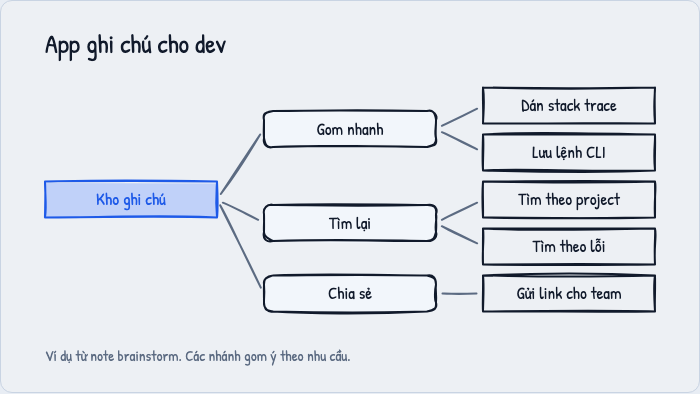</picture> | <picture><source media="(prefers-color-scheme: dark)" srcset="docs/images/examples/31-assumption-map-dark.png">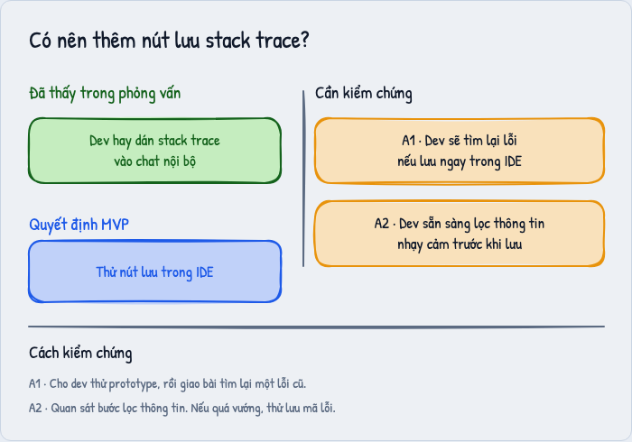</picture> |

| [Story map](examples/32-story-map.json) | [Request walkthrough](examples/33-request-walkthrough.json) |
| --- | --- |
| <picture><source media="(prefers-color-scheme: dark)" srcset="docs/images/examples/32-story-map-dark.png">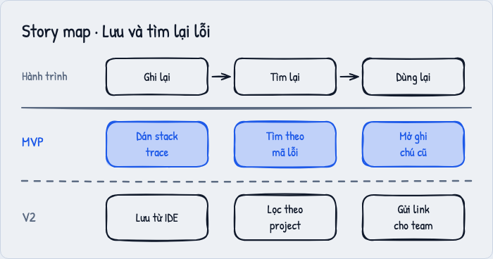</picture> | <picture><source media="(prefers-color-scheme: dark)" srcset="docs/images/examples/33-request-walkthrough-dark.png">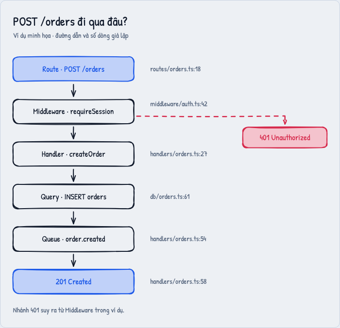</picture> |

| [Async job lifecycle](examples/34-async-job-lifecycle.json) | [PR impact map](examples/35-pr-impact-map.json) |
| --- | --- |
| <picture><source media="(prefers-color-scheme: dark)" srcset="docs/images/examples/34-async-job-lifecycle-dark.png">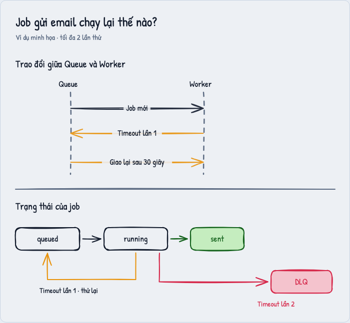</picture> | <picture><source media="(prefers-color-scheme: dark)" srcset="docs/images/examples/35-pr-impact-map-dark.png">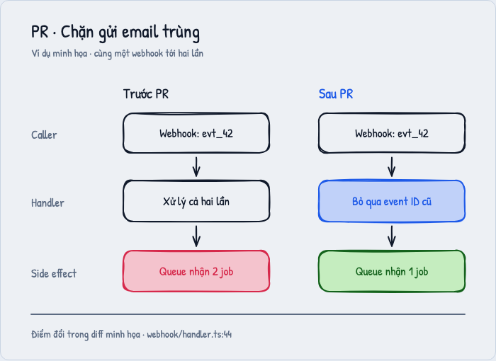</picture> |

| [Incident timeline](examples/36-incident-timeline.json) | [Trace waterfall](examples/37-trace-waterfall.json) |
| --- | --- |
| <picture><source media="(prefers-color-scheme: dark)" srcset="docs/images/examples/36-incident-timeline-dark.png">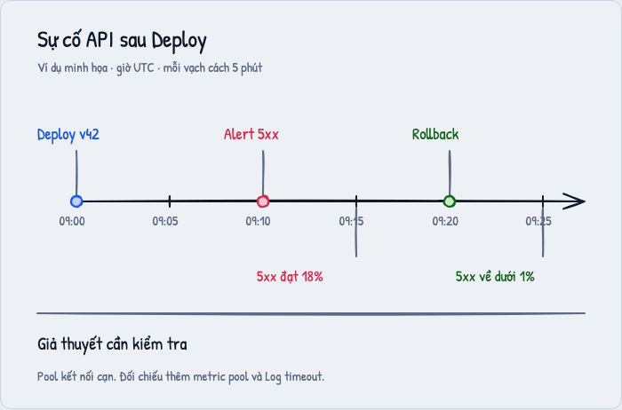</picture> | <picture><source media="(prefers-color-scheme: dark)" srcset="docs/images/examples/37-trace-waterfall-dark.png">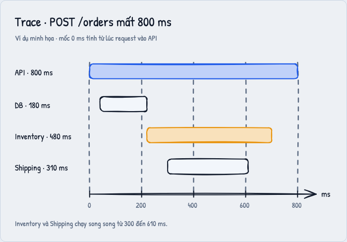</picture> |

### Whiteboard và prototype

Cùng một tình huống nhận hàng tại quầy qua ba góc nhìn. Cảnh minh họa cho thấy người và vật, storyboard cho thấy trải nghiệm, còn prototype thể hiện các trạng thái màn hình.

| [Minh họa bối cảnh](examples/38-whiteboard-scene.json) | [Storyboard](examples/39-storyboard.json) | [Prototype](examples/40-wireframe-prototype.json) |
| --- | --- | --- |
| <picture><source media="(prefers-color-scheme: dark)" srcset="docs/images/examples/38-whiteboard-scene-dark.png">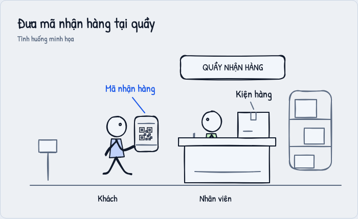</picture> | <picture><source media="(prefers-color-scheme: dark)" srcset="docs/images/examples/39-storyboard-dark.png">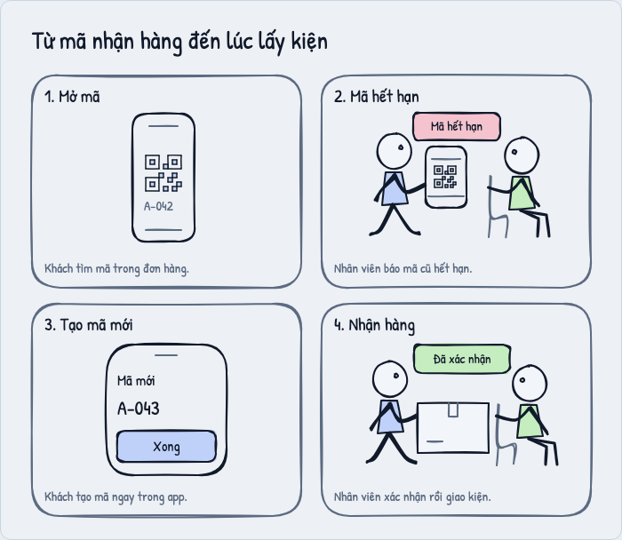</picture> | <picture><source media="(prefers-color-scheme: dark)" srcset="docs/images/examples/40-wireframe-prototype-dark.png">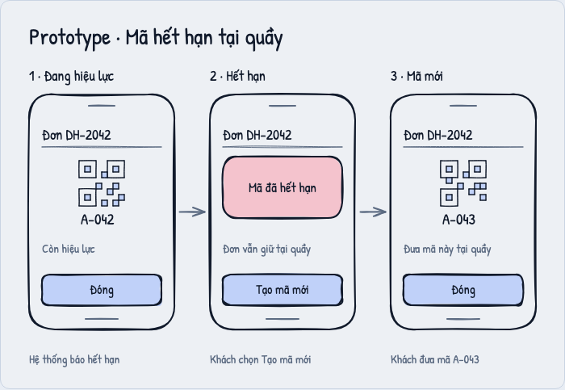</picture> |
| [Excalidraw](docs/images/examples/38-whiteboard-scene.excalidraw) | [Excalidraw](docs/images/examples/39-storyboard.excalidraw) | [Excalidraw](docs/images/examples/40-wireframe-prototype.excalidraw) |

[Spec bộ chi tiết dùng chung](assets/whiteboard-parts.json) · [Canvas để copy chi tiết](docs/images/examples/whiteboard-parts.excalidraw)

### Whiteboard nâng cao

Ba tình huống mô phỏng từ các quy trình thường gặp trong giao hàng, gửi hóa đơn và điều phối workshop. Mỗi canvas kết hợp nhiều vùng nội dung có thể chỉnh sửa.

| [Service blueprint](examples/41-service-blueprint.json) | [UI review board](examples/42-ui-review-board.json) | [Workshop board](examples/43-workshop-board.json) |
| --- | --- | --- |
| <picture><source media="(prefers-color-scheme: dark)" srcset="docs/images/examples/41-service-blueprint-dark.png">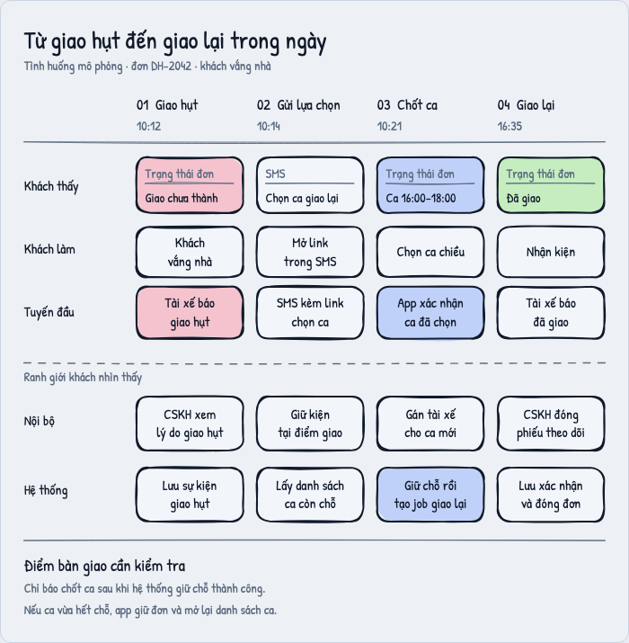</picture> | <picture><source media="(prefers-color-scheme: dark)" srcset="docs/images/examples/42-ui-review-board-dark.png">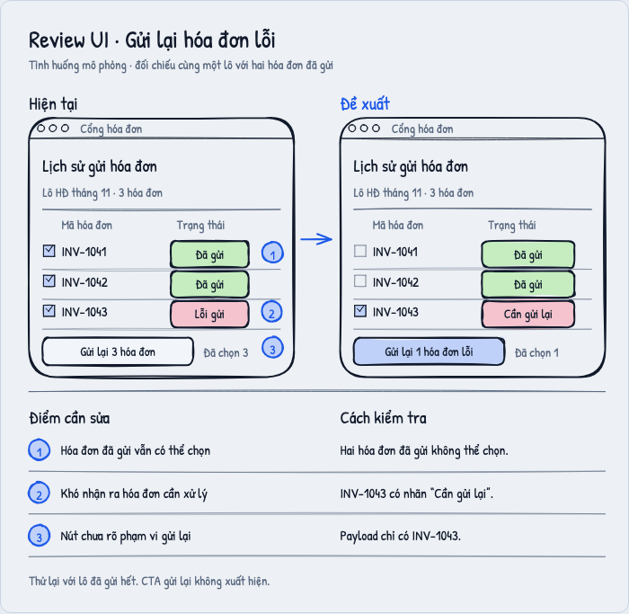</picture> | <picture><source media="(prefers-color-scheme: dark)" srcset="docs/images/examples/43-workshop-board-dark.png">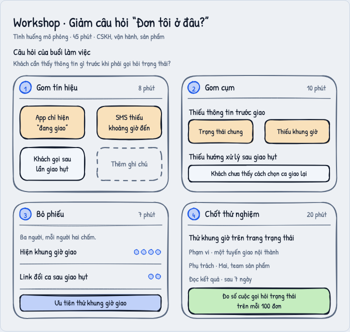</picture> |
| [Excalidraw](docs/images/examples/41-service-blueprint.excalidraw) | [Excalidraw](docs/images/examples/42-ui-review-board.excalidraw) | [Excalidraw](docs/images/examples/43-workshop-board.excalidraw) |

## Màu là nghĩa

Mặc định nét `ink`, không tô nền.
Tối đa ba màu nhấn một hình: `err` cho thứ hỏng, `node` cho kết quả đúng, `l4` cho thứ đang được bàn tới, `warn` cho vùng bị ảnh hưởng, `hot` cho đường đi của một request.
Màu chỉ nhận tên token, công cụ từ chối mã hex - nhờ vậy hình không bao giờ lệch palette và tự đảo đúng ở dark mode.

## Tool tự kiểm những gì

Lỗi cứng (`✗`): hộp bị Excalidraw phình vì chữ không vừa, chữ tràn khung, chữ nhỏ hơn 8px trên màn hình, màu không phải token.
Nhắc nhẹ (`•`): mũi tên xuyên hộp, nhãn dài bằng mũi tên, đầu mũi tên trùng điểm xuất phát của mũi tên khác, hơn ba màu nhấn, hình toàn hộp nối mũi tên.
Còn hình có nói đúng chuyện hay không thì chỉ mắt người kiểm tra được - đó là bước 6.

## Bốn model vẽ cùng một bộ đề

Skill đã được bốn model (Sonnet 5.5, Opus 5.5, Fable 5.2, GLM 5.3) vẽ cùng tám đề - sequence có nhánh, swimlane nghiệp vụ, state lồng nhau, ER crow's foot, system design hai luồng, dải ô byte, ngưỡng và thời gian, trục thời gian.
Xem đủ 32 hình ở [trang so sánh](https://drawing-excalidraw-figures.vercel.app/#so-sanh), kèm số vòng render và kích thước từng hình.

## Cấu trúc repo

```
SKILL.md            bản dẫn đầy đủ của skill - agent đọc file này
scripts/ve.py       renderer: spec JSON -> 4 file
engine/             engine render thật (Excalidraw + Playwright Chromium)
.cache/             bundle Excalidraw dựng sẵn; dựng lại bằng scripts/excalidraw-bundle.mjs
assets/             icons.json 188 icon + font Nunito, Patrick Hand, IBM Plex Mono
references/         luật loại hình, cú pháp spec, ngôn ngữ hình, checklist soi hình
examples/           template spec JSON
evals/              bộ đề đánh giá
tests/              unit cho theme/renderer + golden render tất cả ví dụ
docs/               landing page + bộ so sánh bốn model
```

## Tests

Chuẩn bị: `pip install -r requirements.txt pytest` (riêng golden render cần `playwright install chromium`).
`python3 -m pytest` chạy 69 phép thử: unit cho hệ màu (`engine/theme.py`), cổng token và biên dịch spec (`scripts/ve.py`), dựng icon (`scripts/build_icons.py`), và một golden render chạy `ve.py` thật trên tất cả ví dụ rồi soát màu ngoài token, hex lit thô, cảnh `.excalidraw` hợp lệ.
Muốn bỏ bước render (~80 giây): `python3 -m pytest -m "not slow"`.
GitHub Actions chạy đủ cả bộ ở `.github/workflows/tests.yml`; bundle và font đã commit trong repo nên CI không cần Node và chạy offline.

## Nguồn và giấy phép

- Thư viện [Excalidraw](https://excalidraw.com) và `@excalidraw/mermaid-to-excalidraw`: MIT.
- Icon trong `assets/`: xem `assets/ICONS-LICENSE.txt`.
- Nguồn các luật hình học và phong cách: `references/sources.md`.
- Bản chất mọi luật trong skill đều ghi kèm phép đo thật đã tiến hành trên corpus, không phải suy đoán.
